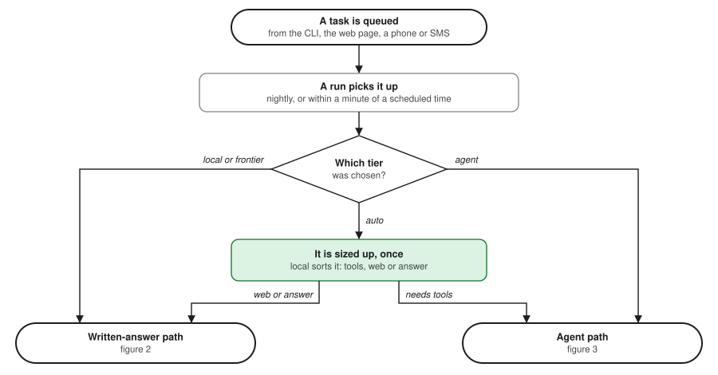
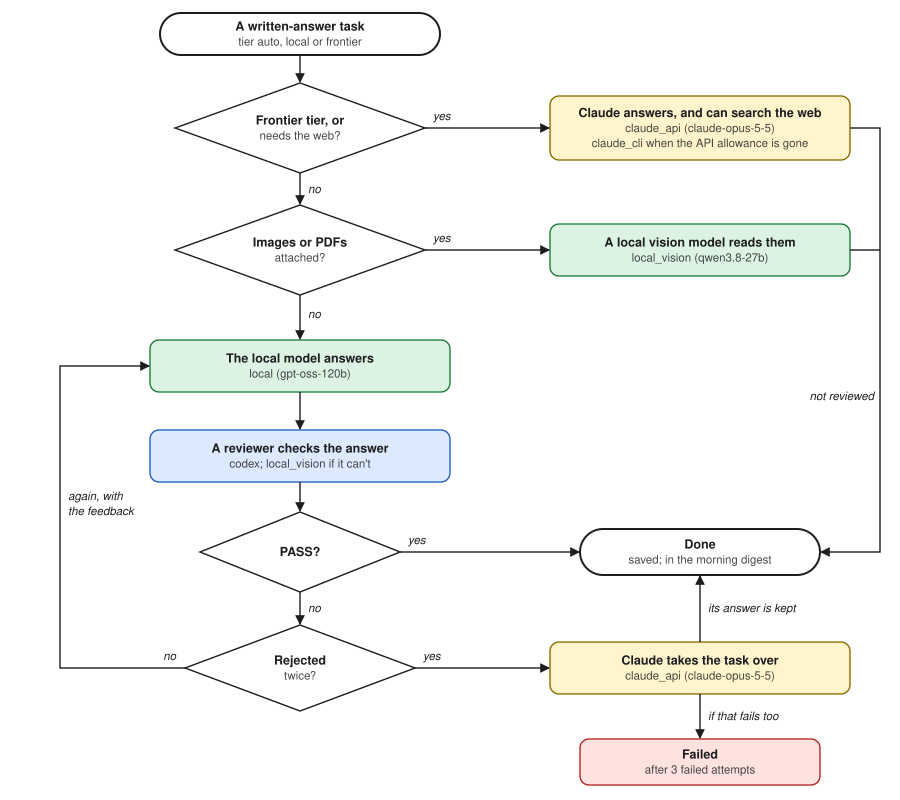
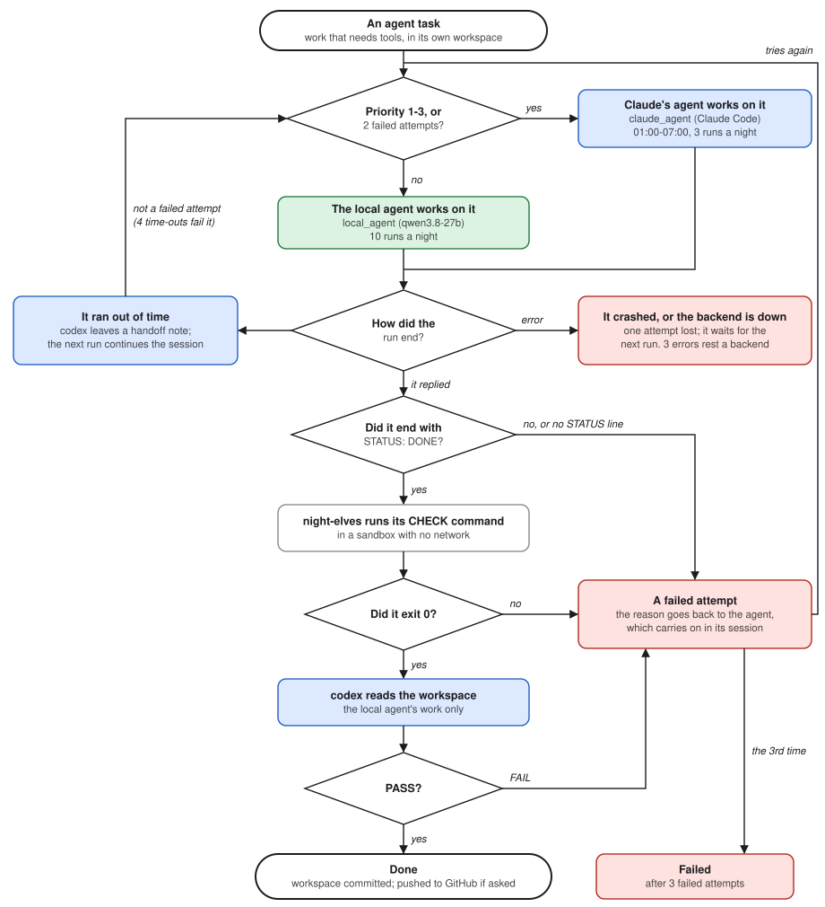

# night-elves

Drop tasks into a queue during the day from the CLI, a web form, or a text
message. Overnight, local models on the Mac Studio work through them. As the
billing cycle runs out, leftover Claude API credit is spent on planning,
review, and the hard tasks instead of expiring unused.

Standard library only. Python 3.11 or newer.

## How it works

```
 CLI ──┐                          ┌─ local      (Ollama / LM Studio / MLX)
 web ──┼─► SQLite queue ─► nightly ┼─ claude_api (monthly API credit, metered)
 SMS ──┘                  run     ├─ claude_cli (`claude -p`, subscription limits)
                                  └─ codex      (`codex exec`, optional reviewer and
                                                 manager of the local agent)
```

What happens to a task, step by step, is drawn on the site's **Explain
workflow?** page (`/workflow`, linked from the queue and the dashboard), where
the boxes name the backends and models your own `config.toml` routes to. The
same three figures for the setup described here:







Green runs on the Mac and is free, blue is a flat-rate plan (claude.ai or
ChatGPT), yellow is the Claude API and is billed, red is a failure.
`python -m elves.workflow assets` redraws the files.

Every model call is written to a `spend` ledger. The API credit is paced from
that ledger, so the dispatcher always knows how much is left and how many days
remain.

| Mode | When | Planner | Executor | Reviewer |
|---|---|---|---|---|
| conserve | first half of the cycle | none | local | codex if enabled, else a local model |
| pace | second half | frontier | local | frontier (local if tonight's allowance is gone) |
| endgame | last 7 days | frontier | frontier for priority 1-3, else local | frontier |

In every mode:

- A task with `--tier frontier` goes straight to the frontier model. If there is
  no allowance left tonight it stays queued.
- A task with `--tier agent` goes to an agent with tools, in a sandbox: the local
  agent first if one is set up, else Claude Code (see [Agent tier](#agent-tier)).
  Its work is accepted only when its own check passes.
- An `auto` task is sized up once, before its first run, by a short call to the
  local model (`roles.classifier`; `"off"` turns it off). One that needs tools
  (clone, build, test, change or push code, make files or media) becomes an agent
  task, and so does one that asks for a repository's code to be reviewed or
  searched for bugs, which takes a clone: reading it page by page over the web
  costs far more and sees less. One that needs current information from the web goes to `claude_api`,
  which searches and fetches pages itself (`server_tools`). When Claude has no
  allowance left tonight, the task goes to the local model if that can search
  (see [Local web search](#local-web-search)); if it can't, the task waits rather
  than be answered from memory. The rest are routed as below. The task page says
  what it was sized up as.
- A task can say when it's done (`--done-when`). The executor, the reviewer and
  the agent are all held to it; without one, the planner writes some.
- A task that fails locally twice is escalated to the frontier model. Failing
  includes a reviewer's FAIL, so local answers get a review even in conserve
  mode: by codex if it's enabled, else by `roles.local_review` (or the local
  model itself).
- "Frontier" means the API credit first. When tonight's allowance is used up,
  it falls back to `claude -p`, which only runs inside its time window and up
  to its nightly run cap, so the subscription is fresh in the morning.
- Tonight's allowance is `remaining / days_left * burst`, capped per night.
  The allowance is checked before each call, not during one.
- One task may use at most `budget.max_usd_per_task` of API credit (default $3,
  `0` for no limit), counted across all its calls since it was last queued. A
  task at the limit fails at once with that reason, instead of retrying. Inside
  a long search-and-read call, Anthropic hands the turn back every ten steps;
  when the cost has reached what the task has left, night-elves has Claude
  write its answer from what it has gathered, without the tools, and the result
  says it was cut short. A call can still pass the limit by up to ten steps
  plus that last answer, so treat it as a brake, not an exact cap. It covers
  billed API calls only, not `claude -p` or agents on the subscription.
- Three failed attempts mark a task `failed`. A reviewer rejection is retried
  the same night with the feedback attached. A backend error costs the task one
  attempt and holds it until the next run, so an outage can't fail a task
  outright. A backend that errors three times in a row is skipped for the rest
  of the run. An agent that worked and then failed doesn't count towards that:
  the backend was up, and the tasks behind it still get their turn.
- An agent that runs out of time hasn't failed. Its files and its session are
  kept, the other tasks get their turn, and then it carries on where it
  stopped, up to twice per agent in one run. Each time counts towards moving
  the task to Claude's agent (`escalate_after`), not towards `max_attempts`.
  A task that runs out of time `limits.max_timeouts` times (default 4) is
  marked `failed`.

## Install

```sh
brew install python            # macOS ships an older Python
git clone https://github.com/jsherman999/night-elves && cd night-elves
brew install pipx && pipx ensurepath
pipx install --editable .      # elf goes in ~/.local/bin; Homebrew Python refuses a plain pip install
mkdir -p ~/.night-elves && cp config.example.toml ~/.night-elves/config.toml
```

Edit `~/.night-elves/config.toml`:

1. Point `[backends.local]` at your model server and name the model.
2. Set `budget.cycle_day` to the day your Claude plan renews.
3. Set `price_in` and `price_out` for the Claude model from the current
   pricing page. The values in the example file are placeholders.
4. Put secrets in `~/.night-elves/env` and `chmod 600` it:

```sh
export ANTHROPIC_API_KEY=...   # from the Console org linked to your Max plan
export ELVES_TOKEN=...         # 16+ characters, for the web and SMS intake
```

## Use

```sh
elf add "Summarise the open issues in ~/notes/issues.md"
elf add -p 1 -t frontier "Design the schema for the access-review tool"
elf add -t agent "Capture 5 seconds of the Bluesky firehose to a JSON file"
elf add --at 01:30 -t agent "Record which hosts answer ping on the LAN"
elf add -t agent --done-when "a screenshot of each form is in shots/" \
        "Clone github.com/me/app, run it, and screenshot its forms with Playwright"
elf add --from 9 "Using these 3B2 notes, build a quick-reference page"
cat spec.md | elf add -
elf list
elf show 3
elf search 3b2 emulator # tasks whose prompt or result has every word
elf archive 3 4         # off the web page's recent list; results are kept
elf unarchive 3
elf budget              # mode, credit spent, tonight's allowance
elf run --dry-run       # show how each queued task would be routed
elf run                 # work the queue now
elf retry 3             # requeue a failed, cancelled or finished task
elf cancel 4 5          # take queued tasks out of the queue
elf edit 4 -t agent -p 2 --at 01:30    # also --prompt, --done-when, --now, --tonight
```

`elf edit` and `elf cancel` only touch tasks that haven't started (queued, failed
or cancelled); once a run picks a task up, it is left alone. `--now` means
"within a minute" (the every-minute job below runs it, and sends the digest);
`--tonight` drops a scheduled time so the 01:00 run takes it. Backend windows
still apply, so an agent task set to run now during the day waits for 01:00.

Results land in `~/.night-elves/results/<id>.md`, with a `digest-<date>.txt`
after each run.

### Nightly schedule

```sh
sed "s/YOU/$USER/g" launchd/com.nightelves.nightly.plist > ~/Library/LaunchAgents/com.nightelves.nightly.plist
launchctl load ~/Library/LaunchAgents/com.nightelves.nightly.plist
```

It runs at 01:00 through `scripts/nightly.sh`, which loads the env file and
wraps the run in `caffeinate` so the Mac stays awake. Adjust the clone path in
the plist if the repo is not in `~/night-elves`.

`caffeinate` only holds the Mac awake once the run has started. If the Mac
sleeps, launchd runs the job when it next wakes, so either stop it sleeping on
power (`sudo pmset -c sleep 0`) or wake it just before the run
(`sudo pmset repeat wakeorpoweron MTWRFSU 00:55:00`).

### Scheduled tasks

`--at` holds a task until a local time: `01:30`, `1:30am`, `2pm`, or
`2026-11-20 07:05`. A bare time means its next occurrence. From the phone,
start the prompt with `at 1:30am` (a colon or am/pm is needed, so "At 5
companies…" is left alone), or send an `at` field to `/tasks`.

A second launch agent, `launchd/com.nightelves.due.plist`, runs
`elf run --due-only` every minute. It only picks up scheduled tasks whose time
has come, and it is silent and sends no digest when there are none. If the
nightly run is busy, it leaves the task to that run, which takes due tasks
before anything else. Install it like the nightly plist.

What "at" means:

- It's "not before", accurate to about a minute when nothing else is running.
- The backend's window still applies: an agent or `claude -p` task set for
  2pm waits for the next 01:00-05:00 window. Local-model tasks run any time.
- A scheduled task that hits a backend error is retried 30 minutes later.
- Nightly caps (API allowance, runs per night) count from local midnight, so
  daytime scheduled runs share the same day's allowance with the night run.

### Web intake

```sh
elf serve               # http://127.0.0.1:8377
curl -H "Authorization: Bearer $ELVES_TOKEN" -H 'Content-Type: application/json' \
     -d '{"prompt":"...","priority":3,"tier":"auto"}' http://127.0.0.1:8377/tasks
```

The server binds to loopback; reach it from elsewhere through Tailscale or a
tunnel instead of opening the port. `launchd/com.nightelves.web.plist` keeps
it running.

**In a browser** (bookmark it, or Share > Add to Home Screen on an iPhone),
`/` asks once for the token, then shows a form to queue a task and the queue
itself: what's running, what's waiting (and when), and recent results. Tap a
task to read its result, edit its prompt, tier, priority or time, run it now,
cancel it, or put it back in the queue. Results are shown formatted from their
Markdown (headings, lists, tables, code, links), with a link to the plain text.
The renderer is in `elves/md.py`: it escapes all source text, shows raw HTML as
text, and only links http(s), mailto and same-site paths. The sign-in is a cookie derived from
the token (HttpOnly, SameSite=Strict, Secure over HTTPS), so changing
`ELVES_TOKEN` signs every browser out.

**As JSON**, with the `Authorization: Bearer` header:

| Request | Does |
|---|---|
| `POST /tasks` `{"prompt", "priority", "tier", "at", "criteria", "from"}` | queue a task (`criteria`: done when; `from`: `"9, 12"` or `[9, 12]`) |
| `POST /tasks` as `multipart/form-data`, same fields plus `files` | queue a task with files |
| `GET /tasks` | the latest 100 tasks |
| `GET /tasks?q=3b2+emulator` | tasks whose prompt or result has every word, each with a `snippet` |
| `GET /tasks/<id>` | one task, with its result text and its files |
| `GET /tasks/<id>/f/<n>` | its nth file (1-based) |
| `POST /tasks/<id>` `{"action": "save", "prompt", "tier", "priority", "at", "criteria"}` | edit it (`"at": ""` clears the time) |
| `POST /tasks/<id>` `{"action": "now" \| "cancel" \| "retry"}` | run it within a minute, cancel it, requeue it |
| `POST /tasks/<id>` `{"action": "archive" \| "unarchive"}` | take a finished task off the recent list, or put it back |

A change to a task a run has already started returns 409.

### Dashboard

`/dashboard` on the web intake (there is a link under the queue) is one page
for what the elves are doing and what it costs:

- **Now:** the task being worked on and for how long, the queue, today's model
  calls and model time, the API credit used this cycle and today, and what
  today's subscription runs would have cost at API prices.
- **Services:** whether the local model server, SearXNG and the browser reader
  answer.
- **Model runs:** time, cost and calls per day for the last 14 days, by backend
  (hover or tap a day for its numbers).
- **Backends:** whether each can run now and why not (its hours, its runs for
  today, tonight's allowance), with today's calls, tokens and time, and its
  cost for today, 7 days and the billing cycle.
- **Tasks** most recently changed, with failed tries, time, cost and last error.
  A task's number opens its page.
- **Model calls:** the latest 80 lines of the ledger.
- **Logs:** the end of `nightly.log`, `due.log` and `web.log` (the files launchd
  writes beside the queue), with a filter box.

Three things open a breakdown when clicked:

- **API credit** lists what was charged this cycle: one line per task and kind
  of call, biggest first.
- **Subscription work today** lists the same for today's runs that were not
  charged.
- **A backend's name** says what that backend is, how it is paid for and which
  roles it fills, with its totals, what kinds of calls it made in the last 14
  days, and its latest calls.

There are two kinds of cost on the page, and only one of them is money you
paid. A plain figure was billed to the API credit; only the `anthropic_api`
backend (`claude_api`) does that. A figure marked "unbilled" is what a
run on a flat-rate plan (`claude -p` on the claude.ai subscription) would have
cost at API prices, worked out from its token counts; nobody was charged it.
Local models cost nothing.

It reloads each minute while it is in front and scrolled to the top.
`/dashboard.json` gives the figures to a script with the bearer token.

Over Tailscale it is part of the site, behind the same sign-in. For the local
network there is a second listener that serves the dashboard and nothing else:

```toml
[web]
view_port = 8378        # http://<the Mac's name or address>:8378
```

```sh
echo "export ELVES_VIEW_TOKEN=$(openssl rand -base64 12)" >> ~/.night-elves/env
```

That listener speaks plain http, so it has a token of its own
(`ELVES_VIEW_TOKEN`, at least 12 characters, not the main one): what crosses the
LAN unencrypted can only read the dashboard, while the token that can queue
work, and so run agents, stays on loopback and Tailscale. The page shows the
start of each task's prompt and the logs, so it still asks for the sign-in.
A task's number opens its page there too, to read only: the prompt, the model
calls, the log lines and the result, with no files and nothing to press.
`view_tasks = false` leaves that out, and the address then shows the dashboard
alone. Queueing, changing and resubmitting tasks, and asking for a guide, are
at the Tailscale address only.

### A task's page, resubmitting, and Guide / fix

`/t/<id>` shows a task's run in full: each model call (backend, kind, tokens,
time, cost), the feedback on its last attempt (a reviewer's, or its failed
check's), the lines of the logs that name it, the manager's plan if there is
one, and the result.

**Run it again with more instructions** takes text and adds it to the end of
the prompt under a dated "More instructions" heading, then puts the task back
in the queue with fresh attempts (a task still waiting just gets the text). An
agent task keeps its workspace and its session, so it carries on from its
earlier work rather than starting over. It runs with the nightly run; **Run
now** starts it within a minute.

**Guide / fix** asks a frontier model to work out those instructions. It is
given the task, its outcome, errors, feedback, model calls, log lines and the
result, and replies with a short diagnosis for you and instructions written to
the model that will redo the task. The page shows the diagnosis and puts the
instructions in the box, where you can change them before sending; nothing is
resubmitted until you press the button. The guide is written in the
background and the page picks it up when it is ready.

`roles.guide` names the backend that writes guides. Left empty, it is Claude
on the subscription (`roles.frontier_sub`), and failing that the API while
tonight's allowance lasts. Because you asked for it, a command backend's hours
and nightly run count don't hold a guide back, but the call is in the ledger
(kind `guide`), so it counts towards that backend's runs for the day.

### Using an earlier task's result

Every result is a Markdown file, `~/.night-elves/results/<id>.md` (an agent's
other files are in `~/.night-elves/work/<id>/`, listed at the end of that
file). To build on one, reference the task when you queue the next:

- `elf add --from 9 "..."` (repeatable, or `--from 9,12`)
- the web form's "Use results of tasks" box, or `"from": "9, 12"` in JSON
- from the phone or SMS, start the prompt with `from #9:` (or `from #9, #12:`)

Each result is attached to the new task as `task-<id>.md`: a copy taken at
queue time, so rerunning task 9 later doesn't change it. As a text file it is
pasted into the prompt for any tier, and an agent also gets it in `input/`. A
task that has no result yet can't be referenced ("#9 has no result yet"), and
results count towards the 200 KB of text a task can carry inline.

### Local web search

A local model answers from memory unless it is given a way to look things up.
Point its backend at a [SearXNG](https://docs.searxng.org/) instance with JSON
output enabled:

```toml
[backends.local]
search_url = "http://127.0.0.1:8888"
```

Handed search tools and left to itself, a local model searches once, opens a
page or two, fills in the rest from memory and says it checked everything. So
night-elves runs the research in stages (`elves/research.py`), and checks in
code whatever code can check:

1. **Plan.** The model lists the searches to run, or says the task needs none
   (then it is answered directly, and the result says so). A task sized up as
   needing the web is always researched.
2. **Search and pick.** night-elves runs the searches; the model chooses which
   results to open. Pages the task itself names are read first.
3. **Read.** One page at a time, the model writes notes, each with a quote from
   the page. A note whose quote isn't on the page is dropped. Links the model
   wants to follow are followed only if they are on that page, and go ahead of
   the other results, so it can go a level deeper.
4. **Write.** The model writes the result from the notes alone.
5. **Trace the links.** Every URL in the result is either a page that was read,
   a link seen on a page or in the results (these are tested: does anything
   answer?), or from nowhere. Dead and from-nowhere links go back to the model
   to be removed.
6. **Check the claims.** In a call of its own, the model (or the backend named
   by `check_with`) compares the result with the notes; unsupported claims go
   back to be corrected.

If fewer than `min_pages` pages gave useful notes, the attempt fails ("research
came up too thin") instead of producing a thin answer; on the `auto` tier two
such failures escalate the task to Claude. Under each result is a research
record written by night-elves, not the model: the searches, the pages notes
came from, what couldn't be opened, where the cited links came from (any that
survived as dead or made up are named), and what the claim check found.

Settings, on the backend, with their defaults:

```toml
max_queries = 6      # searches planned
max_pages = 10       # pages opened; a third of them are kept for followed links
min_pages = 2        # fewer with useful notes is a failure
page_chars = 12000   # of a page per reading call
page_parts = 2       # reading calls per page (so 24,000 characters are read)
max_probes = 12      # cited links tested for being there
check_with = ""      # another backend to check the claims, e.g. "local_vision"

[backends.local.extra]         # added to every request to this backend as it is
reasoning_effort = "high"      # e.g. gpt-oss in LM Studio: low | medium | high
```

A research task makes a dozen or more model calls and takes minutes, not
seconds. Pages are fetched by `elves/webtools.py` (standard library only):
http(s) only, at most 3 MB, and only from hosts that resolve to public
addresses, redirects included, so a page can't steer a fetch into this Mac's own
services or the LAN. Files that aren't text (archives, PDFs) count as existing
but aren't read.

#### Pages that need a browser

The plain fetch gets nothing from a page that is drawn by JavaScript. Point the
backend at a [Jev browser service](https://github.com/jsherman999/jev_local_web_seatch-)
and those pages are read in a real, headless Chrome instead:

```toml
[backends.local]
reader_url = "http://127.0.0.1:8776"
reader_pages = 4      # browser reads per task
reader_timeout = 90   # seconds each
```

The browser is tried only when the plain fetch is refused (HTTP 401, 403, 429
and the like) or an HTML page comes back with under 400 characters of text, and
never for the link probes of stage 5. It is asked to dismiss a consent banner
and stop: no following links, no forms. What it read goes through the same
stages as any page, and the research record says which pages were read that
way and why. The service's bearer token is read from `$ELVES_READER_TOKEN`
(put it in `~/.night-elves/env`); it is removed from what agents and their
checks are given, so a check, which may reach localhost, can't use the browser
to reach the internet.

What it doesn't do: get past a bot check. Cloudflare and its like turn a
headless browser away too, and on the Studio Stack Overflow, Reddit and npm all
answered with a "verify you are human" page. Those reads are refused (the
record says "the site's bot check stopped the browser too"), so such a page is
never handed to the model as the page. And the browser, unlike the plain fetch,
is not held to the public internet: the URL is checked before it is sent, and a
read that passed through a private address is thrown away, which keeps that
page's text from the model but can't stop the request being made. Each read
sends the page to TypeSafe (Jev's model) and costs a fraction of a cent.

Two limits remain. The checks catch invented links, misquoted pages and claims
the notes don't support; they can't tell whether the right pages were found or
whether a page is itself wrong, so a local model's research is still a draft.
And the model reads untrusted pages while holding the task's text: it can't run
anything, but a hostile page could in principle steer which links get fetched.
Don't give this tier secrets alongside open-ended browsing.

### Finding and archiving past tasks

To find the number of a task to build on, search by keyword: `elf search 3b2
emulator`, the search box above the queue on the web page, or `GET
/tasks?q=...`. A task matches when its prompt or its result file contains
every word (case is ignored; the first 2 MB of each result is read). Matches
are listed newest first with the text around the first hit. On the web page,
each match that has a result gets a Use button, which adds its number to the
form's "Use results of tasks" box.

A finished, failed or cancelled task can be archived: the Archive button on
its row under Recent or on its page, or `elf archive <id>`. That only takes it
off the web page's recent list. The task, its result file and its workspace
stay on disk, so it still turns up in searches (marked "archived"), still
opens at `/t/<id>`, and still works with `--from` / `from #9:`. "Show archived
tasks" under Recent lists them with an Unarchive button; running an archived
task again also brings it back.

### Files and images

A task can carry up to 20 files of any type: a screenshot to build something
from, a CSV to analyse, a PDF to summarise, a log to dig through. Attach them
with the form's file picker, `elf add -f data.csv -f notes.md "..."` on the
Studio, `curl` from anywhere on the tailnet:

```sh
curl -H "Authorization: Bearer $ELVES_TOKEN" -F 'prompt=Find the outliers' -F tier=agent \
     -F files=@sales.parquet -F files=@notes.md https://<studio>.ts.net/tasks
```

or an iPhone share-sheet Shortcut. `scripts/make-shortcut.py https://<studio>.ts.net`
builds and signs a ready-made one, "Send to Elves" (it needs macOS signed in to
iCloud). Open the file to import it; Shortcuts asks for the token then, so the
file itself holds no secret, and iCloud syncs it to the phone. To build it by hand:

1. New Shortcut, turn on **Show in Share Sheet**, receiving **Images** and **Files**.
2. **Ask for Input** (text): "What should the elves do?"; **List** `agent`, `auto`,
   `frontier` and **Choose from List**.
3. **Get Contents of URL**: `https://<studio>.ts.net/tasks`, method POST,
   header `Authorization: Bearer <ELVES_TOKEN>`, request body **Form** with
   `prompt` = Provided Input, `tier` = Chosen Item, and `files` as a **File**
   field set to Shortcut Input. (`images` is accepted too.)
4. **Get Dictionary Value** `message`, then **Show Notification**. Errors carry
   a `message` too ("Not queued: ..."), so failures show up the same way.

With a bearer token the reply is JSON (`{"id", "files", "message"}`); the
browser form gets the queue page. Uploads are streamed to disk, so size is
limited only by `[web] max_upload_mb` (2048 by default) and free space. A
multipart upload must carry the bearer header or the sign-in cookie, checked
before anything is read.

Each file gets a kind when it arrives, and the kind decides who can work on it:

| Kind | What | Who |
|---|---|---|
| text | UTF-8, up to 200 KB for all of a task's text files together | any tier: pasted into the prompt |
| image | PNG, JPEG, GIF, WebP, HEIC (converted to JPEG; shrunk past 2048 px or 3.75 MB with `sips`) | Claude, or the local vision model |
| pdf | up to 30 MB | Claude, or the local vision model up to 20 pages |
| data | anything else, or text past the 200 KB budget | `agent` only |

**Local vision.** The general local model may not see images (gpt-oss-120b
doesn't). Name a second local backend with `vision = true` in
`roles.local_vision` (see `config.example.toml`) and images, plus PDFs of up
to 20 pages, go to it: `local` uses it, and `auto` uses it first, like the
local model for text, moving to Claude after two failed attempts or for
priority 1-3 tasks in the endgame. There is no planner or reviewer for these,
since they couldn't see the images. Images go as data URLs in the OpenAI
format; PDF pages are rendered to PNG by `elves/pdfpages.swift`, which is
compiled with `swiftc` the first time a PDF arrives (macOS with the Xcode
command line tools) and also counts the pages at intake. Without a vision
backend, `local` refuses images and PDFs and `auto` sends them to Claude.

So without a local vision model, `auto` sends a task with images or PDFs to
the frontier model; with one, it sends it there first. A task
with data files has to be queued as `agent` (the agent tier stays opt-in, so
it isn't chosen for you). The agent gets copies in `work/<id>/input/`, made
with APFS clones so a big file isn't stored twice and the original stays
untouched. The frontier model gets images and PDFs inline through the API, or,
on the `claude -p` fallback, as files in the attachments folder it runs in.

Files are stored in `~/.night-elves/attachments/<id>/` under generated names
(`2-sales.csv`: the position, then the upload's name with anything outside
`A-Z a-z 0-9 . _ -` replaced), and listed on the task's page. Images show as
thumbnails; images, PDFs and text open in the browser, and everything else
(HTML and SVG included, which are treated as text or data) is shown as plain
text or downloaded, never run. SMS intake is text only.

### SMS intake

Two ways:

- **Through an agent gateway.** If Hermes Agent (or similar) already answers
  your texts, have it run `elf add --source sms "<message>"`.
- **Twilio-style webhook.** Point the number's webhook at
  `https://<your-tunnel>/sms?key=<ELVES_TOKEN>` and list your phone number in
  `web.sms_allow`. Start a message with `!` for priority 1, `opus:` to
  request the frontier tier, `agent:` for the agent tier, `at 1:30am` to
  schedule it, or `from #9:` to attach task 9's result. These can be combined
  in any order. The same shorthand works
  for prompts posted to `/tasks` without a `tier`.

### Morning digest

Set `[notify].argv` to any command that can deliver text. For iMessage, use
`scripts/imessage.applescript` with the recipient's phone number or Apple ID:

```toml
[notify]
argv = ["osascript", "/Users/YOU/night-elves/scripts/imessage.applescript", "+16125550123", "{text}"]
```

Set `[web].public_url` to the address the phone pages are reached at (your
Tailscale name, for example) and each finished or failed task in the digest
gets a link to its result page.

Messages must be signed in to iMessage on the Mac that runs the queue. If it
is signed in to your own Apple ID and the recipient is you, the digest lands
in your conversation with yourself, which iOS doesn't notify for. The
first send from launchd asks for permission to control Messages: approve it
on that Mac's screen (Screen Sharing works), or allow it later in System
Settings > Privacy & Security > Automation. Until then the send fails, the
failure is logged, and the digest is still written to the results folder.

## Backends

| Type | Use for | Cost tracking |
|---|---|---|
| `openai_compat` | any OpenAI-compatible local server | tokens only |
| `anthropic_api` | Claude API key | dollars, from token counts and your prices |
| `command` | any CLI that takes a prompt and prints an answer | runs per night; tokens (and API-price estimates, where the tool gives them) with `output = "claude-json"`, `"opencode-json"` or `"codex-json"` |

Every call's time, tokens and cost go in the ledger, and each finished or failed
task shows them in the web UI: wall-clock time over all attempts, tokens in and
out, the API credit billed, and, for subscription runs (`claude -p` with
`--output-format json`), what the same work would have cost at API prices. Local
models cost $0.

`claude_api` runs with thinking on (Opus can't turn it off), and thinking counts
against `max_tokens`, so keep that high (32000): at 8192, hard tasks used the
whole budget thinking and came back empty. An empty reply now says why (out of
tokens, or declined). `effort` sets how hard it thinks, and `fallbacks` (on
unless set to false) reruns a declined request on another model.

A `command` backend passes the prompt as an argument where `{prompt}` appears
in `argv`, or on stdin if it does not. Nothing goes through a shell.
`ANTHROPIC_API_KEY` is removed from its environment, because `claude -p` bills
the API key instead of your subscription when the key is set, and the ledger
would record that spend as $0. Set `env_unset` on the backend to change the
list.

## Agent tier

Most tasks are text in, text out. A task queued with `--tier agent` instead
runs an agent with tools, so it can run commands, write files and fetch from
the network. It is opt-in per task. Two agents can take it:

- **The local agent** (`local_agent` in `config.example.toml`, used when
  `roles.local_agent` names it): opencode driving a local model (Qwen3.8-27B on
  the Studio), inside Anthropic's sandbox runtime. It runs any time, so an agent
  task set to run now during the day starts within a minute. It goes first.
- **Claude Code** (`claude_agent`): takes a task after the local agent has
  failed it or run out of time on it twice (`escalate_after`), and takes priority 1-3 tasks
  (`hard_priority`) from the start. Without a local agent it takes them all.

The `claude_agent` backend:

- runs in `~/.night-elves/work/<id>/`, and the result file lists what was saved there
- uses `--restricted`, so your user, project and local Claude settings,
  hooks and MCP servers are ignored, and the file tools stay in the workspace
- loads `~/.night-elves/agent-settings.json`, a copy of
  `agent-settings.example.json`: Bash runs in the macOS sandbox with writes
  limited to the workspace, reads of `~/.ssh`, `~/.config`, keychains and the
  night-elves secrets denied, network limited to `allowedDomains`, and no
  fallback to unsandboxed commands
- uses `--permission-mode dontAsk`, so anything not allowed is refused rather
  than waiting for a person
- never sees `ANTHROPIC_API_KEY` or `ELVES_TOKEN`, so it can't bill the API or
  queue tasks for itself
- stops after 200 turns, or after `timeout` seconds (90 minutes), when its
  whole process group is killed
- runs inside the subscription window, up to `max_runs_per_night`

It is set up to build small apps in one go: the allowlist covers PyPI, npm,
crates.io, GitHub and the common front-end CDNs; package caches (`uv`, `pip`,
`npm`, `cargo`) point into the workspace through the backend's `env` table;
`allowLocalBinding` lets it start a dev server and test against it; and the
instructions it gets ask for a README, a passing build and tests, and no
servers left running. The sandbox never lets it write `.git/config` or hooks,
so it can't `git init`; night-elves commits the workspace to git itself when
the task finishes, leaving out caches, `node_modules`, `target` and venvs. It can only use the toolchains already installed
(Node, Python via `uv`, Rust, Swift on the Studio), because it can't install
Homebrew packages. `allowLocalBinding` also lets it reach other services on
localhost, such as LM Studio's API.

On the Studio, `sudo`, writes to the home folder, reads of `~/.ssh` and
connections to unlisted hosts were all refused by the sandbox. A deny rule
alone is not a boundary (`sh -c "sudo …"` gets past it); the sandbox is what
stopped it. Add hosts a task needs to `allowedDomains`.

### Pushing to GitHub

The sandbox has no GitHub credentials, and won't get any. When a task asks for a
push, the agent is told to commit in its clone and end with
`PUSH: <clone folder> <branch>`. (It clones with `--separate-git-dir`, because
the sandbox blocks writes under a `.git` folder; the git directory has to be
inside the workspace.) Once its check passes, night-elves pushes that
branch from the host with your own git credentials, if:

- the task's text asks for a push,
- the clone's origin is on GitHub under an owner in `[push].owners`, and
- the push is a fast-forward (it is never forced).

Git is not run on the host inside the agent's clone, whose config and hooks the
agent controls: the branch is bundled inside the check sandbox, fetched into a
fresh repository, and pushed from there. The result file says what was pushed.

### Tools and network

Agents can use whatever is installed on the Mac (`ls /opt/homebrew/bin`), but
can't install anything system-wide; on the Studio that includes Node, Python
(`uv`), Rust, Go, Swift, Java, ffmpeg and ImageMagick. macOS won't nest
sandboxes, so SwiftPM needs `--disable-sandbox`, which the agents are told. The
sandbox can't allow every site: `allowedDomains` takes names and `*.name`
wildcards but refuses `*`, so the examples list package registries, GitHub,
Hugging Face, docs sites and CDNs. Claude's agent also has `WebFetch` and
`WebSearch`, which reach any site outside the shell sandbox.

### Done means checked

An agent doesn't get to declare itself finished. Its instructions end with a
contract: the last two lines of its reply must be

```
STATUS: DONE            (or INCOMPLETE)
CHECK: <one shell command that exits 0 only when the work is right>
```

When the agent exits, night-elves runs the `CHECK` command itself, from the
workspace, under `sandbox-exec` with its own profile: writes only in the
workspace and the temp folders, no network except localhost, no secrets, and
`sudo`, `osascript`, `security`, `launchctl` and `ssh` refused. It gets
`check_timeout` seconds (10 minutes), and anything it leaves running is killed.
The work is accepted only on `STATUS: DONE` and a check that exits 0. A missing
STATUS line, `INCOMPLETE`, or a failing check counts as a failed attempt, and the
next attempt is told why, including the end of the check's output. The task's
`--done-when` text, if it has one, is in the agent's instructions too, and the
check should test it. `CHECK: none` is accepted, for tasks that only gather
information; the result says so.

The result file has a **Check** section with the command, its exit code and
the end of its output. A rejected attempt's result is kept too, marked "not
accepted", and the workspace is committed to git after every attempt, so you
can see what each one did.

### Retries continue the session

A retry doesn't start over. Each agent task keeps a session id
(`session_args`/`resume_args` on the backend): Claude Code gets `--session-id`,
then `--resume`, and opencode gets `--session ses_…`, which creates the session
the first time and continues it after. So an agent that hit its time limit or
turn limit, or whose check failed, carries on with everything it knew, and is
told what went wrong. If the session has gone (Claude prints "No conversation
found"), it starts a new one in the same workspace, told that the earlier files
are there. A task that moves from the local agent to Claude starts a Claude
session, with the same workspace and the same feedback.

Some failures leave a session that can't continue. opencode stops with
"compaction.failed" when the model can't summarise a full context, and resuming
that session would stop the same way. A backend's `new_session_on` lists text
to look for in the last error (`["compaction"]` for the local agent); when it
is there, the next run starts a new session in the same workspace.

Give the local model as much context as the Mac has memory for, so that
compaction is rare: load it in LM Studio with at least the `limit.context` in
`opencode.json` (131072 in the example; `lms load <model> --context-length
131072`). opencode trusts that number, and a model loaded with less fails
part-way through long tasks.

### A manager for the local agent

A local model working as an agent fails in ways its own check doesn't catch: it
reports DONE on work that misses half the task, or it works for its whole time
limit without finishing. A stronger model can watch over it for a fraction of
what doing the work would cost. Three roles name that manager, each off until
set, and each used only for the local agent's tasks (Claude's agent is the
stronger model, so nobody manages it):

| Role | When | What the manager does |
|---|---|---|
| `agent_review` | the agent said DONE and its check passed | Reads the workspace and the check, and replies PASS or FAIL. A FAIL is a failed attempt: the agent's next run gets the faults to fix. |
| `agent_handoff` | a run stopped at its time limit, or crashed part-way | Reads the workspace and the end of what the agent printed, and writes the next run a note: what works, what is left, the next steps. |
| `agent_plan` | before the agent's first run | Writes a plan of small steps and a "Done when" list, which the reviewer checks too. Written once per task (again if the task is edited) and kept in `work/<id>.plan.md`. |

So the layers are: the local agent does the work, the manager plans, checks
and unsticks it, and after `escalate_after` failed attempts the task goes to
Claude's agent as before.

The manager never holds a task up. If it isn't set, is out of runs for the
night, or fails, the task goes on as it would without one. After three
failures in a row, or one call that runs out of time, the manager is left
alone for the rest of the run. The same
goes for the reviewer of a local answer: when it fails, the local reviewer
reviews instead, and the task doesn't lose an attempt.

#### More than one backend in a role

`frontier_sub`, `agent`, `second_opinion`, `guide`, `stand_in` and the three
`agent_*` manager roles take either a backend's name or a list of them, the
preferred first:

```toml
[roles]
agent = ["claude_agent", "other_agent"]   # the second works when Claude's is outside its hours
agent_review = ["codex", "another"]       # the second reads the work when Codex can't
```

The first backend in the list that can run now does the job: one that is
switched off, outside its `window`, out of runs for the night, or marked down
for the run is passed over. For a review or a manager's call, a backend whose
call fails is also followed by the next. The other roles name one backend.

#### A stand-in for the manager

A flat-rate plan runs out: Codex stops at its `max_runs_per_night`, or its
weekly limit, or it hangs once and is left alone for the rest of the run.
`roles.stand_in` names a backend that takes the call instead:

- for the manager roles that are set (`agent_review`, `agent_handoff`,
  `agent_plan`), when the manager can't run now, or its call fails;
- for the review of a local answer, when `second_opinion` can't run or fails.
  The order is `second_opinion`, then `stand_in`, then the local reviewer.

It is asked only when the one named for the job couldn't do it, and a role that
is off stays off. If the stand-in fails too, the task goes on as before: an
answer is reviewed locally, and an agent's work is accepted on its check. The
result file and the task's page name whoever gave the review.

`[backends.cmd_review]` in `config.example.toml` is Command Code's `cmd` in that
role, with `srt-cmd-review.example.json`: it can read the workspace, write only
its own `~/.commandcode`, and reach only Command Code. Shown a `slugify` that
passed its one weak test but left doubled and trailing hyphens, `qwen/qwen3.7-max`
replied FAIL and named both faults and the thin test; shown the fixed one, PASS.
The two reviews took 14 and 23 seconds and read 32K and 114K tokens. At the
plan's rate (about $0.40 per million tokens read, measured on 2026-11-15) that
is 1 to 5 cents a review, against the Go plan's caps of $3 per five hours and
$6 per week. The task and what it reads in the workspace go to Command Code and
the model's host.

To use Codex on a ChatGPT plan as the manager:

```sh
npm i -g @openai/codex                    # not the Homebrew cask: see below
codex login --device-auth                 # prints a code to enter in any browser
cp srt-codex.example.json ~/.night-elves/srt-codex.json
```

Then copy the `[backends.codex]` block from `config.example.toml` without
`enabled = false`, and set the roles to `"codex"`. Codex runs inside srt with
its own settings file: it can read the workspace but write only its own
`~/.codex`, can't read the secrets the agents can't, and reaches only OpenAI.
Codex's own sandbox is switched off, because macOS can't start one sandbox
inside another, and its read-only mode would still let it read `~/.ssh`.
`SSL_CERT_FILE` is set because the sandbox stops Codex asking macOS which
certificates to trust. The task, the end of the agent's reply and whatever the
manager reads in the workspace go to OpenAI.

Install Codex with npm on a Mac that runs unattended. Homebrew's cask marks the
binary as downloaded, so Gatekeeper assesses it at every launch, and on the
Studio one of those assessments never finished: after that, every `codex`
started from that path hung before its first instruction (`log stream` showed
syspolicyd "waiting on another evaluation"), until the cask was removed.

`scripts/agent-bench.py <model> --manager codex --plan` measures what a manager
adds on this Mac: the same hidden-test tasks through the dispatcher with the
model alone, with review and handoff, and with the plan too.

### A hosted model as the first agent

`roles.local_agent` is whichever agent is tried first, before Claude's; it
doesn't have to run on the Mac. `[backends.cmd_agent]` in `config.example.toml`
drives a hosted open model through [Command Code](https://commandcode.ai)'s
`cmd` CLI, inside srt with `srt-cmd.example.json`. Set `roles.local_agent =
"cmd_agent"` to use it; the manager roles then review and unstick its work as
they would the local agent's, and Claude's agent still takes over after
`escalate_after` failures.

A probe on 2026-11-15 found that inside srt `cmd` can write in the workspace and
reach its API, and is refused `~/.ssh`, writes elsewhere, unlisted sites and
`sudo`. `NODE_USE_ENV_PROXY=1` is needed, or it can't connect at all. It signs
in with `cmd login` in a real terminal (its key expires and needs renewing), or
with `COMMAND_CODE_API_KEY`.

The same hidden-test tasks as the local models, through the dispatcher with no
manager, twice each (`agent-bench.py <model> --backend cmd_agent --manager none`):

| Model | Passed all hidden tests | Mean time | Tokens read, 6 runs |
|---|---|---|---|
| `qwen/qwen3.7-max` | 6 of 6 | 91 s | 1.4M |
| `deepseek/deepseek-v4.1-flash` | 5 of 6 | 196 s | 2.7M |
| `zai-org/glm-5.2` | 4 of 6 | 228 s | 1.4M |

Every run finished on its first attempt. On the Studio the day before, local
gpt-oss-120b passed 3 of 8 the same way, and local qwen3.8-27b ran out of a
900-second limit on every run. The task and everything the agent reads go to
Command Code and the model's host, and each run spends the plan's credit.

### Gemini, through Antigravity

A Google AI plan reaches Gemini through the Antigravity CLI, `agy` (Gemini CLI
stopped serving personal plans on 2026-06-18). `[backends.gemini]` in
`config.example.toml` is a reviewer and writer of answers; `[backends.gemini_agent]`
is an agent. Install it with Google's script
(`curl -fsSL https://antigravity.google/cli/install.sh | bash`), then run `agy`
once in a terminal to sign in; over SSH it prints an address and takes the code
you paste back. Put either backend in a role, alone or in a list after the one
you prefer: `agent_review = ["codex", "gemini"]`.

`agy` differs from the other CLIs in ways the two sandbox files allow for:

- It keeps its sign-in in the macOS Keychain, not in a file, so the sandbox
  can't deny `~/Library/Keychains`, and it needs `enableWeakerNetworkIsolation`
  to check certificates. It also listens on a local port.
- It exits 0 when it couldn't sign in or the model failed; `output = "agy-json"`
  reads the status it reports instead.
- It names its conversations itself. `session_args = []` with `resume_args =
  ["--continue"]` continues the last one of the task's workspace.

**As a reviewer** (`srt-agy-review.example.json`) it is as contained as Codex:
without a terminal of its own `agy` can't run any command, so it reads files
and nothing else, writes only `~/.gemini`, and reaches only Google. A probe on
2026-11-18 confirmed each of those. Shown the `slugify` that passed its one
weak test, Gemini 4 Argon and Gemini 3.8 Flash both replied FAIL and named the
faults; shown the fixed one, PASS; 20 to 33 seconds and 19K to 39K tokens each.

**As an agent** (`srt-agy.example.json`) it needs a terminal, and then a
command it runs can ask the Keychain for any entry that doesn't require
approval. In the probe a command inside the sandbox could read Claude Code's
sign-in and GitHub's token as well as `agy`'s own. The rest held: no writing
outside the workspace, no `~/.ssh`, no site off the list, no `sudo`. `agy`'s own
`--sandbox` is no substitute: it kept commands from the Keychain and `~/.ssh`,
but let them write in the home folder and reach any site. Use the agent backend
only on a Mac whose Keychain holds nothing you would mind an agent reading.

The hidden-test tasks, through the dispatcher with no manager, twice each
(`agent-bench.py <model> --backend gemini_agent --manager none`):

| Model | Passed all hidden tests | Mean time | Tokens read, 6 runs |
|---|---|---|---|
| `gemini-4-hydrogen-high` | 6 of 6 | 106 s | 1.0M |
| `gemini-4-argon-medium` | 6 of 6 | 163 s | 0.6M |

Every run finished on its first attempt. The plan's quota refreshes every five
hours up to a weekly limit; night-elves can't read it, so `max_runs_per_night`
is the brake. The task and what the model reads go to Google.

### Setting up the local agent

On the Studio this needs opencode, LM Studio with the model loaded, and
Anthropic's [sandbox runtime](https://www.npmjs.com/package/@anthropic-ai/sandbox-runtime):

```sh
npm i -g @anthropic-ai/sandbox-runtime          # the srt command
cp srt-settings.example.json ~/.night-elves/srt-settings.json
cp opencode.example.json ~/.night-elves/opencode.json
```

Then copy the `[backends.local_agent]` block from `config.example.toml` and set
`roles.local_agent = "local_agent"`. `srt-settings.json` matches the sandbox in
`agent-settings.example.json`: writes only in the workspace (`"."`, as srt runs
there), the same denied reads, and the same domain allowlist; keep the two in
step. opencode runs with `--standalone`, so its tools run in srt with it rather
than in opencode's background service, and with `--auto`, as nobody is there to
approve anything. Its config, sessions and caches are pointed into the
workspace by the backend's `env` table.

### Browsers

Playwright's Chromium is installed for the agents to use
(`npx playwright@1.65.0 install chromium`, into `~/Library/Caches/ms-playwright`).
Agents can't download a browser themselves, so their `notes` (added to their
instructions) tell them to use that exact Playwright version, and to launch
Chromium with `--single-process`: inside the sandbox it can't register the Mach
port its helper processes need, and fails with `bootstrap_check_in ...
Permission denied` otherwise. The check sandbox doesn't have that limit.

Images an agent saves in its workspace (screenshots, say) are shown on the
task's page, up to 24 of them; hidden folders, `node_modules` and the like are
left out, and only PNG, JPEG, GIF and WebP files are served.

### Home network

`scripts/allow-lan.py` adds every address on the Mac's local subnets to
`allowedDomains` in `~/.night-elves/agent-settings.json`, and in
`srt-settings.json` for the local agent if it's there (the sandbox has no
CIDR syntax, so it's one entry per host; `--remove` takes them out, and a
re-run refreshes them after the network changes). What agent tasks can then do
on the LAN, as tested on the Studio:

- connect to devices over TCP, but only through the sandbox proxy: the private
  ranges are in `NO_PROXY`, so tools must be told to use the proxy
  (`curl --noproxy ''`, or an HTTP CONNECT in scripts)
- read the ARP table (`arp -an`) to see recently active devices
- not ping, use UDP (mDNS/Bonjour, SSDP, SNMP), capture packets, or read
  per-process traffic stats (`nettop`)

So it can find devices and talk to their web pages and APIs, but it can't
measure how much traffic each device sends; that needs your router's stats.

## Limits to know about

- **Only agent-tier tasks use tools.** The local and API backends do not
  run commands or touch files. A reviewer only reads the answer; only an
  agent's check actually runs anything.
- **A check is only as good as the agent makes it.** night-elves runs it and
  believes its exit code; a weak check (`CHECK: test -f README.md`) passes weak
  work. `--done-when` is the way to say what the check should prove, and a
  manager (`roles.agent_review`) reads the local agent's work as well.
- **Subscription usage is not measured.** Neither Claude nor ChatGPT plan
  limits are read; those backends are held back by a time window and a run
  count. Only the API credit is paced in dollars.
- **The ledger only sees its own spend.** If you use the same API key
  elsewhere, lower `monthly_credit_usd` to what you want night-elves to have.
- **The SMS webhook checks a shared secret and a sender allowlist.** It does
  not verify Twilio's request signature.
- **One task at a time.** A lock file stops two runs overlapping (the nightly run
  waits for a daytime one, such as a long local agent task, to finish), and tasks are
  worked serially. `parent_id` is in the schema for splitting a task into
  subtasks, but the dispatcher does not do that yet.
- **Provider billing rules change.** How `claude -p` and third-party tools are
  billed against subscriptions changed more than once in 2026. Each backend is
  a config block, so repoint or disable one when that happens.

## Tests

```sh
python -m unittest discover -s tests
```
